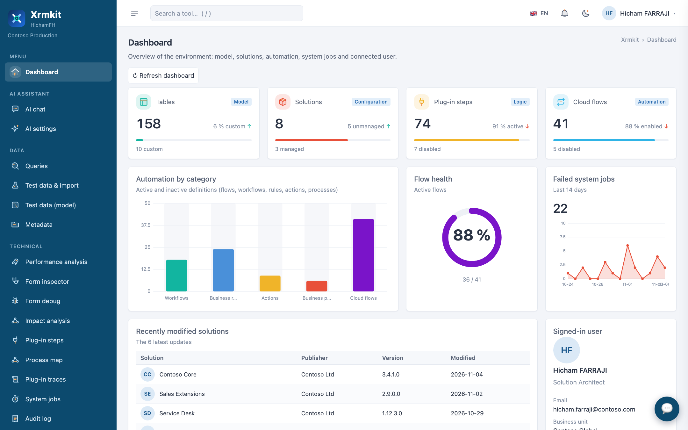

# Xrmkit

Une extension Chrome pour celles et ceux qui construisent et exploitent des applications pilotées par modèle Dynamics 365 et Power Platform. English: [README.md](README.md)

Xrmkit comprend deux parties. Une petite fenêtre (le popup) sert aux gestes rapides sur le formulaire ouvert : copier l'ID d'un enregistrement, afficher les noms logiques, ouvrir un enregistrement par son ID. Le Workbench s'ouvre dans son propre onglet et regroupe les outils plus lourds : requêtes, analyse d'impact, carte des automatisations d'une table, rapport de droits par utilisateur, comparaison d'environnements, documentation de solutions et un chat IA facultatif.

Tout s'exécute dans votre navigateur, avec la session Dynamics déjà ouverte. Il n'y a pas de serveur Xrmkit, pas de statistiques d'usage et pas de code distant.



*Les captures utilisent des données de démonstration.*

## Sommaire

- [Contenu](#contenu)
- [Installation](#installation)
- [Utilisation](#utilisation)
- [Modèles de rapport Word](#modèles-de-rapport-word)
- [Assistant IA](#assistant-ia)
- [Confidentialité et sécurité](#confidentialité-et-sécurité)
- [Fonctionnement](#fonctionnement)
- [Développement](#développement)
- [Limites connues](#limites-connues)
- [À venir](#à-venir)
- [Contribuer](#contribuer)
- [Licence](#licence)

## Contenu

Les outils sont rangés comme dans le menu du Workbench.

| Groupe | Outil | Ce qu'il fait |
|---|---|---|
| Données | Requêtes | FetchXML, OData et appels Web API bruts. Valeurs formatées, pagination jusqu'à 50 pages, requêtes enregistrées, export CSV et JSON. Toute écriture demande une confirmation. |
| | Données de test et import | Génère des données de test (et les supprime), importe un CSV avec simulation, modifie en masse en demandant de saisir le nombre d'enregistrements. |
| | Données de test (modèle) | Produit des enregistrements cohérents à partir des métadonnées d'une table : types, colonnes obligatoires, liens. |
| | Métadonnées | Tables, colonnes, listes de choix avec valeurs et libellés, relations. |
| Technique | Cartographie des processus | Plug-ins, flux cloud, workflows et règles métier d'une table dans l'ordre d'exécution de Dataverse, avec les cascades entre tables et les boucles possibles. |
| | Analyse d'impact | Où une colonne, une table, une liste de choix ou une web resource est utilisée, via `RetrieveDependentComponents`. |
| | Étapes de plug-ins, traces | Navigation assembly, plug-in, étapes avec activation et désactivation. Filtres et détail des traces. |
| | Tâches système, journal d'audit | Tâches en échec ou en attente. Historique des modifications d'un enregistrement. |
| | Inspecteur et debug de formulaire | Champs, handlers lus dans la définition du formulaire, appels réseau, erreurs JavaScript, suivi des changements en direct. |
| | Analyse de performance | Temps de chargement, appels API lents ou répétés, scripts lourds, tâches longues, avec historique des mesures. |
| Sécurité | Rapport d'accès utilisateur | Rôles directs et via les équipes, droits effectifs par table avec leur niveau, droits sensibles signalés. |
| | Pourquoi cet accès | Accès effectif à un enregistrement (`RetrievePrincipalAccess`) et comparaison de deux rôles côte à côte. |
| | Impersonation | Exécute les requêtes du Workbench au nom d'un autre utilisateur (`MSCRMCallerID`). Demande le privilège d'agir au nom d'un autre utilisateur. |
| Fonctionnel | Documentation de solutions | Diagrammes d'architecture et entité-relation, matrice des automatisations, cas d'utilisation déduits. Export HTML, Word, Markdown avec Mermaid, Excel et JSON. |
| | Dictionnaire de données | Colonnes, listes de valeurs et relations vers Excel ou Word. |
| Environnements | Comparer des environnements | Deux environnements ouverts comparés en direct : solutions, tables, rôles, plug-ins, flux, variables, références de connexion et plus. Rapport de livraison Word ou Excel. |
| | Éléments hors solution, santé des flux | Composants personnalisés absents de toute solution non gérée. Flux en échec, suspendus ou inactifs. |
| | Tableau de bord | Tables, solutions, étapes de plug-ins et flux en un coup d'œil. |
| IA | Chat | Facultatif. Voir [Assistant IA](#assistant-ia). |

Le popup propose God Mode, les noms logiques, les valeurs des listes de choix, les champs modifiés, la copie des ID et des URL, l'ouverture d'un enregistrement ou d'une liste, la recherche avancée, un rapport de bug avec capture d'écran et des raccourcis vers le Workbench.

L'interface existe en français et en anglais, avec un thème sombre.

## Installation

Il faut Chrome 111 ou plus récent et une application pilotée par modèle Dynamics 365 ou Power Apps sur Dataverse. Les applications Finance and Operations ne sont pas prises en charge, car elles n'exposent pas la même API côté client.

Les domaines pris en charge sont `dynamics.com`, `microsoftdynamics.us`, `appsplatform.us` et `dynamics.cn`. Pour un autre domaine (un serveur sur site, par exemple), ajoutez-le dans `host_permissions` et dans `content_scripts.matches` du `manifest.json`.

### Depuis le paquet de version

1. Téléchargez le dernier `xrmkit-x.y.z.zip` (les paquets de version sont rangés dans le dossier [`dist/`](dist) de ce dépôt) et décompressez-le. Vous obtenez un dossier `xrmkit` qui contient `manifest.json`.
2. Ouvrez `chrome://extensions` et activez le **Mode développeur** (en haut à droite).
3. Cliquez sur **Charger l'extension non empaquetée** et choisissez le dossier `xrmkit`.
4. Ouvrez votre application Dynamics 365 et rechargez la page (F5) si elle était déjà ouverte.
5. Cliquez sur l'icône Xrmkit dans la barre d'outils. Épinglez-la depuis le menu en forme de pièce de puzzle si vous voulez la garder visible.

Gardez le dossier à sa place : Chrome charge l'extension depuis cet emplacement. Un avertissement « Mode développeur » apparaît au démarrage, ce qui est normal pour une extension non empaquetée.

### Depuis les sources

```bash
git clone <url-du-depot> xrmkit
cd xrmkit
```

Suivez ensuite les étapes 2 à 5 avec le dossier cloné. Il n'y a pas d'étape de compilation : ce que vous voyez dans le dossier est ce que Chrome exécute.

### Mise à jour et suppression

Pour mettre à jour, remplacez le contenu du dossier par la nouvelle version et cliquez sur l'icône de rechargement de la carte de l'extension dans `chrome://extensions`. Pour la supprimer, cliquez sur **Supprimer** sur cette même carte. Tout ce que l'extension avait enregistré est effacé avec elle.

## Utilisation

**Popup.** Cliquez sur l'icône depuis une page Dynamics. Les boutons agissent sur le formulaire courant. Si la page indique qu'elle n'est pas prête, rechargez-la avec F5 : l'extension s'attache au chargement de la page.

**Workbench.** Cliquez sur **Ouvrir le Workbench** dans le popup. Il s'ouvre dans un nouvel onglet et dialogue avec l'onglet Dynamics qui l'a lancé : laissez cet onglet ouvert. La zone de recherche de la barre du haut (touche `/`) filtre le menu des outils. Les boutons de langue et de thème sont dans la même barre.

**Un Workbench par environnement.** Pour comparer deux environnements, ouvrez chacun dans son onglet, lancez le Workbench depuis l'un, puis choisissez l'autre dans l'outil de comparaison.

**Essayez les écritures sur un environnement de développement.** L'import, la modification en masse, l'activation ou la désactivation d'étapes et l'impersonation changent des données ou un comportement réels. Ils demandent une confirmation, et les actions destructrices demandent de la saisir, mais l'habitude la plus sûre est de les utiliser sur un environnement de développement ou de test.

## Modèles de rapport Word

La cartographie des processus, le rapport d'accès utilisateur et le dictionnaire de données peuvent remplir un modèle Word que vous fournissez, pour que le résultat garde vos styles, votre logo, votre en-tête et votre pied de page.

1. Dans le rapport, ouvrez **Rapport Word à partir de votre modèle** et cliquez sur **Télécharger un modèle de départ**. Il contient toutes les balises proposées par le rapport.
2. Modifiez-le dans Word : déplacez, supprimez ou mettez en forme à votre guise.
3. Cliquez sur **Importer un modèle**, choisissez-le dans la liste, puis cliquez sur **Générer le rapport**.

Les balises s'écrivent entre doubles accolades.

| Syntaxe | Effet |
|---|---|
| `{{nom}}` | Remplacé par la valeur. |
| `{{objet.champ}}` | Lit un champ d'un objet. |
| `{{#liste}}` ... `{{/liste}}` dans une ligne de tableau | Répète la ligne pour chaque élément. |
| `{{#liste}}` et `{{/liste}}` seuls dans deux paragraphes | Répète tout ce qui se trouve entre les deux. |
| Les deux balises dans un même paragraphe | Répète le texte entre elles, sur la même ligne. |
| `{{#valeur}}` ... `{{/valeur}}` sur une valeur qui n'est pas une liste | Affiche le contenu seulement si la valeur est renseignée. |

Les boucles peuvent s'imbriquer (le dictionnaire de données répète les colonnes dans chaque table). Les balises fonctionnent aussi dans les en-têtes et pieds de page. Si Word découpe une balise en plusieurs morceaux à cause de la mise en forme, Xrmkit les recolle. Les valeurs sont insérées comme du texte : des données qui contiennent des accolades ne sont donc jamais lues comme une balise. Une balise sans donnée correspondante reste vide et apparaît dans la liste affichée après la génération.

Les noms de balises sont fixés par l'extension, et la plupart sont en français (`{{utilisateur}}`, `{{lire}}`). Le modèle de départ les présente avec une description, et le code est dans [`workbench/reports.js`](workbench/reports.js). Un modèle est un fichier .docx ou .dotx de 3 Mo au plus, conservé uniquement dans le navigateur.

## Assistant IA

Le chat est inactif tant que vous ne l'avez pas configuré. Ouvrez **Réglages IA** dans le Workbench, choisissez un fournisseur (Anthropic, OpenAI ou Cloudflare Workers AI) et collez votre propre clé d'API. Cloudflare demande aussi un identifiant de compte et un jeton avec la permission Workers AI.

L'assistant voit la page ouverte, la table, le formulaire et les erreurs récentes, et vous pouvez retirer chaque élément avant l'envoi. **Voir ce qui part** affiche le texte exact. Il lit les métadonnées avec des outils en lecture seule (tables, colonnes, relations, listes de choix, solutions, étapes, flux, détails du formulaire, requêtes en lecture seule). Il peut proposer un changement, comme modifier un enregistrement ou activer une étape, mais ne l'exécute jamais sans votre confirmation, et cette confirmation nomme l'environnement.

Le mode confidentiel est actif par défaut : aucune valeur d'enregistrement n'est envoyée. Les e-mails, téléphones, IBAN et longs numéros sont aussi masqués. Les clés sont conservées pour la session du navigateur seulement, ou dans un coffre chiffré par un mot de passe de votre choix. L'historique du chat reste sur votre machine et disparaît au bout de 30 jours.

## Confidentialité et sécurité

- Les requêtes vers Dynamics passent par la page où vous êtes connecté. Vous ne voyez que ce que vos rôles de sécurité permettent, et Xrmkit ne peut pas s'accorder plus.
- Pas de télémétrie, pas de statistiques, pas de rapport d'erreurs et pas de serveur Xrmkit.
- Pas de code distant. Tous les scripts sont dans le paquet, en JavaScript simple, sans étape de compilation ni bibliothèque tierce. La politique de sécurité du contenu est `script-src 'self'; object-src 'self'; base-uri 'none'; frame-ancestors 'none'`.
- Les permissions Chrome sont `storage`, `clipboardWrite` et `activeTab`, plus les domaines Dynamics ci-dessus. Les domaines des fournisseurs d'IA (`api.anthropic.com`, `api.openai.com`, `api.cloudflare.com`) ne sont contactés que lorsque vous utilisez le chat.
- Stocké localement : préférences, requêtes enregistrées, mesures, modèles importés et historique du chat.

Pour signaler un problème de sécurité, ouvrez un ticket sans données clients réelles, ou contactez directement l'auteur.

## Fonctionnement

Trois éléments dialoguent entre eux.

```
popup / Workbench  --chrome.tabs.sendMessage-->  src/content.js  --postMessage-->  src/injected.js
 (pages de l'extension)                          (monde isolé)                      (monde de la page, accès à Xrm)
```

`src/injected.js` s'exécute dans le monde JavaScript de la page, où `Xrm` et la Web API de même origine sont disponibles. `src/content.js` relaie les messages entre ce monde et les pages de l'extension. Comme les appels à la Web API partent de la page, ils utilisent les cookies de l'utilisateur et l'extension ne manipule aucun jeton.

```
manifest.json
_locales/            nom et description de l'extension (en, fr)
icons/
popup/               actions rapides
src/                 content.js, injected.js
workbench/
  workbench.html     l'ordre des scripts compte : icons, i18n, charts, logic, office, workbench, helpers, reports, registry, tabs-*, chat, main
  workbench.js       q() et rows() pour la Web API (cache de 60 s, fusion des GET identiques), h() pour le DOM, secrets, askAI()
  registry.js        Xrmkit.registerTab() et Xrmkit.lazy()
  logic.js           logique pure : CSV, matrice de droits, graphe de flux, cascades
  office.js          écriture .xlsx et .docx, lecture ZIP, moteur de modèles Word
  reports.js         panneau d'import de modèle et de génération de rapport
  tabs-*.js, chat.js, soldoc*.js, main.js
tests/               tests unitaires et test de fumée jsdom
docs/images/         captures utilisées dans ce fichier
```

`logic.js` et `office.js` n'ont ni DOM ni accès réseau, ce qui permet de les tester sous Node.

## Développement

Il n'y a ni bundler, ni transpileur, ni dépendance à installer pour faire tourner l'extension. Modifiez un fichier, cliquez sur l'icône de rechargement de la carte de l'extension, et rechargez l'onglet Dynamics si vous avez touché à un content script.

Les tests demandent seulement Node 20 ou plus récent :

```bash
npm install     # installe jsdom, utilisé par le test de fumée
npm test
```

`tests/unit.test.js` couvre le moteur de modèles Word (archives compressées et balises coupées entre plusieurs morceaux), la logique des droits et des cascades, et vérifie que chaque rapport produit un modèle de départ utilisable. `tests/smoke.test.js` charge le Workbench dans jsdom avec un faux backend Dynamics, ouvre les principaux onglets, importe un modèle, génère un rapport et contrôle l'interface anglaise. Aucun des deux ne dit comment répond un vrai environnement, voir plus bas.

### Ajouter un outil

Créez `workbench/mon-outil.js` :

```js
Xrmkit.registerTab({
  id: 'monOutil', group: 'Technique', icon: 'bolt',
  title: 'Mon outil', desc: 'Ce que fait l\'outil.',
  i18n: { en: { title: 'My tool', desc: 'What the tool does.' } },
  render: async (root) => {
    const data = await rows('accounts?$select=name&$top=5');
    root.append(h('p', {}, data.map((r) => r.name).join(', ')));
  },
});
```

puis ajoutez `<script src="mon-outil.js"></script>` dans `workbench.html`, avant `main.js`. Pour un gros outil, utilisez `Xrmkit.lazy('id', ['fichier.js'])` : le fichier ne se charge qu'à la première ouverture de l'onglet.

### Conventions

- Le texte source, les noms de variables et les commentaires sont en français, langue de travail du projet. Chaque chaîne visible doit aussi exister dans `workbench/i18n-en.js`, avec le texte français exact comme clé, sinon elle reste en français dans l'interface anglaise.
- Aucune dépendance distante et aucune télémétrie. Tout appel externe va vers un fournisseur d'IA choisi par l'utilisateur, après confirmation et masquage.
- Les messages de commit suivent Conventional Commits (`feat:`, `fix:`, `docs:`, `test:`, `chore:`).

## Limites connues

- Plusieurs requêtes ont été écrites d'après la documentation et testées seulement contre un backend simulé : les colonnes de `flowruns`, `connectionreferences`, `environmentvariablevalues`, `RetrieveRolePrivilegesRole`, `RetrieveCurrentOrganization` et `RetrieveUserPrivileges` (le rapport d'accès se rabat sur les privilèges des rôles si cette dernière n'est pas disponible). Elles restent à valider sur de vrais environnements.
- La cartographie lit les étapes de plug-ins et les définitions des flux, workflows et règles. Elle ne lit pas le code des plug-ins : les tables modifiées par du code personnalisé n'apparaissent donc pas dans les cascades.
- Le rapport d'accès montre le niveau le plus élevé entre les rôles et les équipes. Il ne couvre ni les enregistrements partagés avec un utilisateur ni la sécurité au niveau des colonnes.
- L'export Word de la documentation de solutions ne contient pas les diagrammes. Utilisez l'export HTML et imprimez-le en PDF.
- Les cas d'utilisation de la documentation de solutions sont déduits de la configuration et demandent une relecture.
- Seul Chrome a été essayé. D'autres navigateurs Chromium peuvent fonctionner.

## À venir

- Analyseur de stack trace pour l'outil de traces de plug-ins.
- Tableau de bord : renommer la jauge des flux (elle ne mesure que activé ou désactivé) et corriger son sous-titre.
- Analyse de performance : médiane de trois mesures, attente après le chargement et indicateur de fiabilité.
- Analyse d'impact : modèles d'e-mail, rapports, variables d'environnement et colonne de confiance.
- Publication sur le Chrome Web Store.
- Traduction anglaise des derniers longs paragraphes d'aide.

## Contribuer

Les rapports de bug sont la contribution la plus utile. Indiquez la version de Xrmkit (visible en bas du popup), l'outil utilisé, ce que vous attendiez, le message d'erreur s'il y en a un, et le type d'application Dynamics. Merci de ne pas joindre de données d'enregistrements ni de secrets. Le bouton **Rapport de bug** du popup rassemble l'essentiel pour vous.

Pour une modification de code, restez sur des changements petits et ciblés, lancez `npm test`, ajoutez une entrée anglaise pour toute nouvelle chaîne visible et écrivez le message de commit au format Conventional Commits.

## Licence

Aucune licence n'a été choisie pour l'instant : c'est donc le régime par défaut qui s'applique, tous droits réservés par l'auteur. Pour réutiliser le code, contactez-le d'abord.

## Auteur

Conçu et développé par HichamFH. Xrmkit est un projet indépendant, sans lien avec Microsoft ni approuvé ou parrainé par Microsoft. Dynamics 365, Power Platform et Dataverse sont des marques du groupe de sociétés Microsoft.
