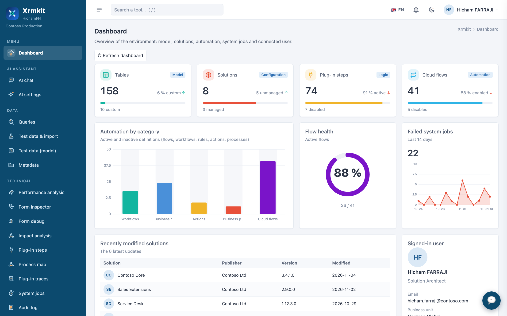

# Xrmkit

A Chrome extension for people who build and run Dynamics 365 and Power Platform model-driven apps. Français : [README.fr.md](README.fr.md)

Xrmkit has two parts. A small popup handles quick jobs on the form you are looking at (copy a record ID, show logical names, open a record by ID). The Workbench opens in its own tab and holds the heavier tools: queries, impact analysis, a map of the automations on a table, a rights report per user, environment comparison, solution documentation and an optional AI chat.

Everything runs in your browser, through the Dynamics session you are already signed in with. There is no Xrmkit server, no analytics and no remote code.



*Screenshots use demonstration data.*

## Contents

- [What is in it](#what-is-in-it)
- [Install](#install)
- [Using it](#using-it)
- [Word report templates](#word-report-templates)
- [AI assistant](#ai-assistant)
- [Privacy and security](#privacy-and-security)
- [How it works](#how-it-works)
- [Development](#development)
- [Known limitations](#known-limitations)
- [Planned work](#planned-work)
- [Contributing](#contributing)
- [License](#license)

## What is in it

Tools are grouped the same way as in the Workbench menu.

| Group | Tool | What it does |
|---|---|---|
| Data | Queries | FetchXML, OData and raw Web API calls. Formatted values, paging up to 50 pages, saved queries, CSV and JSON export. Anything that writes asks first. |
| | Test data and import | Generates test data (and removes it again), imports a CSV with a dry run, bulk updates with a typed confirmation of the record count. |
| | Test data (model) | Builds consistent records from a table's metadata: types, required columns, lookups. |
| | Metadata | Tables, columns, option sets with values and labels, relationships. |
| Technical | Process map | Plug-ins, cloud flows, workflows and business rules of a table in Dataverse execution order, with the cascades between tables and possible loops. |
| | Impact analysis | Where a column, table, option set or web resource is used, using `RetrieveDependentComponents`. |
| | Plug-in steps, traces | Assembly, plug-in, step drill down with enable and disable. Trace filters and detail. |
| | System jobs, audit log | Failed and waiting jobs. Change history of a record. |
| | Form inspector, form debug | Fields, handlers read from the form definition, network calls, JavaScript errors, live change watching. |
| | Performance analysis | Load time, slow and repeated API calls, heavy scripts, long tasks, with a history of measurements. |
| Security | User access report | Direct and team roles, effective rights per table with their depth, sensitive rights flagged. |
| | Why does this user have access | Effective access to one record (`RetrievePrincipalAccess`) and a side by side comparison of two roles. |
| | Impersonation | Runs Workbench requests as another user (`MSCRMCallerID`). Needs the privilege to act on behalf of another user. |
| Functional | Solution documentation | Architecture and entity-relationship diagrams, automation matrix, deduced use cases. Exports to HTML, Word, Markdown with Mermaid, Excel and JSON. |
| | Data dictionary | Columns, value lists and relationships to Excel or Word. |
| Environments | Compare environments | Two open environments compared live across solutions, tables, roles, plug-ins, flows, variables, connection references and more. Word or Excel delivery report. |
| | Items outside solutions, flow health | Custom components that belong to no unmanaged solution. Failed, suspended or idle flows. |
| | Dashboard | Tables, solutions, plug-in steps and flows at a glance. |
| AI | Chat | Optional. See [AI assistant](#ai-assistant). |

The popup covers God Mode, logical names, option set values, changed fields, copying IDs and URLs, opening a record or a list, advanced find, a bug report with a screenshot, and shortcuts to the Workbench.

The interface is available in English and French. There is a dark theme.

## Install

You need Chrome 111 or later and a Dynamics 365 or Power Apps model-driven app on Dataverse. Finance and Operations apps are not supported because they do not expose the same client API.

Supported domains are `dynamics.com`, `microsoftdynamics.us`, `appsplatform.us` and `dynamics.cn`. For another domain (on-premises, for example), add it to `host_permissions` and to `content_scripts.matches` in `manifest.json`.

### From the release package

1. Download the latest `xrmkit-x.y.z.zip` and unzip it. You get a folder called `xrmkit` with `manifest.json` inside.
2. Open `chrome://extensions` and turn on **Developer mode** (top right).
3. Click **Load unpacked** and choose the `xrmkit` folder.
4. Open your Dynamics 365 app and reload the page (F5) if it was already open.
5. Click the Xrmkit icon in the toolbar. Pin it from the puzzle-piece menu if you want it always visible.

Keep the folder where it is. Chrome loads the extension from there, and it will show a Developer mode notice at startup, which is normal for unpacked extensions.

### From source

```bash
git clone <repository-url> xrmkit
cd xrmkit
```

Then follow steps 2 to 5 above with the cloned folder. There is no build step: what you see in the folder is what Chrome runs.

### Updating and removing

To update, replace the folder content with the new version and click the reload icon on the extension card in `chrome://extensions`. To remove it, click **Remove** on the same card. That also deletes everything the extension stored.

## Using it

**Popup.** Click the icon on a Dynamics page. The buttons act on the current form. If the page says it is not ready, reload it with F5: the extension attaches when the page loads.

**Workbench.** Click **Open the Workbench** in the popup. It opens in a new tab and talks to the Dynamics tab that launched it, so keep that tab open. The search box in the top bar (press `/`) filters the tool menu. Use the language and theme buttons in the top bar to switch.

**One Workbench per environment.** To compare two environments, open each in its own tab, launch the Workbench from one, and pick the other in the comparison tool.

**Try writes on a dev environment first.** Import, bulk update, enabling or disabling steps and impersonation change real data or behaviour. They ask for confirmation, and destructive ones ask you to type it, but the safest habit is to use them on a development or test environment.

## Word report templates

The process map, the user access report and the data dictionary can fill a Word template you provide, so the result keeps your own styles, logo, header and footer.

1. In the report, open **Word report from your template** and click **Download a starter template**. It contains every tag the report offers.
2. Edit it in Word. Move, delete or restyle things as you like.
3. Click **Import a template**, choose it from the list and click **Generate the report**.

Tags are written between double braces.

| Syntax | Effect |
|---|---|
| `{{name}}` | Replaced by the value. |
| `{{object.field}}` | Reads a field of an object. |
| `{{#list}}` ... `{{/list}}` in one table row | Repeats the row once per item. |
| `{{#list}}` and `{{/list}}` alone in two paragraphs | Repeats everything between them. |
| Both tags in one paragraph | Repeats the text between them inline. |
| `{{#value}}` ... `{{/value}}` on a non-list value | Shows the content only when the value is filled. |

Loops can be nested (the data dictionary repeats columns inside tables). Tags also work in headers and footers. If Word splits a tag in several pieces because of formatting, Xrmkit joins it back. Values are inserted as text, so data containing braces is never read as a tag. Tags with no matching data are left empty and listed after the report is generated.

Tag names are fixed by the extension and most of them are in French (`{{utilisateur}}`, `{{lire}}`). The starter template shows each one with a description, and the code is in [`workbench/reports.js`](workbench/reports.js). Templates are .docx or .dotx files up to 3 MB and are stored in the browser only.

## AI assistant

The chat is off until you configure it. Open **AI settings** in the Workbench, pick a provider (Anthropic, OpenAI or Cloudflare Workers AI) and paste your own API key. Cloudflare also needs an account ID and a token with the Workers AI permission.

The assistant sees the page you are on, the table, the form and recent errors, and you can remove any of these before sending. **See what is sent** shows the exact text. It reads metadata through read-only tools (tables, columns, relationships, option sets, solutions, steps, flows, form details, read-only queries). It can propose a change, such as updating a record or enabling a step, but never performs it without your confirmation, and that confirmation names the environment.

Confidential mode is on by default: no record values are sent. Emails, phone numbers, IBANs and long numbers are masked as well. Keys are kept for the browser session only, or in a vault encrypted with a password you choose. Chat history stays on your machine and is deleted after 30 days.

## Privacy and security

- Requests to Dynamics go through the page you are signed in to. You can only see what your security roles allow, and Xrmkit cannot grant itself more.
- No telemetry, no analytics, no crash reporting and no Xrmkit backend.
- No remote code. All scripts are in the package, written in plain JavaScript with no build step and no third-party library. The content security policy is `script-src 'self'; object-src 'self'; base-uri 'none'; frame-ancestors 'none'`.
- Chrome permissions are `storage`, `clipboardWrite` and `activeTab`, plus the Dynamics domains above. The AI provider domains (`api.anthropic.com`, `api.openai.com`, `api.cloudflare.com`) are only contacted when you use the chat.
- Stored locally: preferences, saved queries, measurements, imported templates and chat history.

To report a security problem, open an issue without real customer data in it, or contact the author directly.

## How it works

Three pieces talk to each other.

```
popup / Workbench  --chrome.tabs.sendMessage-->  src/content.js  --postMessage-->  src/injected.js
 (extension pages)                               (isolated world)                   (page world, has Xrm)
```

`src/injected.js` runs in the page's own JavaScript world, where `Xrm` and the same-origin Web API are available. `src/content.js` relays messages between that world and the extension pages. Because the Web API calls are made from the page, they use the user's cookies and no token is ever handled by the extension.

```
manifest.json
_locales/            extension name and description (en, fr)
icons/
popup/               quick actions
src/                 content.js, injected.js
workbench/
  workbench.html     script order matters: icons, i18n, charts, logic, office, workbench, helpers, reports, registry, tabs-*, chat, main
  workbench.js       q() and rows() for the Web API (60 s cache, duplicate GET merging), h() for DOM, secrets, askAI()
  registry.js        Xrmkit.registerTab() and Xrmkit.lazy()
  logic.js           pure logic: CSV, access matrix, flow graph, cascades
  office.js          .xlsx and .docx writing, ZIP reading, Word template engine
  reports.js         template import and report generation panel
  tabs-*.js, chat.js, soldoc*.js, main.js
tests/               unit tests and a jsdom smoke test
docs/images/         screenshots used in this file
```

`logic.js` and `office.js` have no DOM and no network access, which is why they can be tested under Node.

## Development

There is no bundler, no transpiler and no dependency to install to run the extension. Edit a file, click the reload icon on the extension card, and reload the Dynamics tab if you changed a content script.

Tests only need Node 20 or later:

```bash
npm install     # installs jsdom, used by the smoke test
npm test
```

`tests/unit.test.js` covers the Word template engine (including compressed archives and tags split across runs), the rights and cascade logic, and that every report spec produces a working starter template. `tests/smoke.test.js` loads the Workbench in jsdom with a fake Dynamics backend, opens the main tabs, imports a template, generates a report and checks the English interface. Neither can tell you how a real environment answers; see below.

### Adding a tool

Create `workbench/my-tool.js`:

```js
Xrmkit.registerTab({
  id: 'myTool', group: 'Technique', icon: 'bolt',
  title: 'Mon outil', desc: 'Ce que fait l\'outil.',
  i18n: { en: { title: 'My tool', desc: 'What the tool does.' } },
  render: async (root) => {
    const data = await rows('accounts?$select=name&$top=5');
    root.append(h('p', {}, data.map((r) => r.name).join(', ')));
  },
});
```

then add `<script src="my-tool.js"></script>` to `workbench.html` before `main.js`. For a large tool, use `Xrmkit.lazy('id', ['file.js'])` so the file loads when the tab is first opened.

### Conventions

- Source text, variable names and code comments are in French, because that is the working language of the project. Every visible string must also exist in `workbench/i18n-en.js`, keyed by the exact French text, otherwise it shows in French in the English interface.
- No remote dependency and no telemetry. Any external call must be to an AI provider the user chose, after confirmation and masking.
- Commit messages follow Conventional Commits (`feat:`, `fix:`, `docs:`, `test:`, `chore:`).

## Known limitations

- Several requests were written from the documentation and tested only against a simulated backend: the `flowruns` columns, `connectionreferences`, `environmentvariablevalues`, `RetrieveRolePrivilegesRole`, `RetrieveCurrentOrganization` and `RetrieveUserPrivileges` (the access report falls back to role privileges when the last one is unavailable). They need validating on real tenants.
- The process map reads plug-in steps and the definitions of flows, workflows and rules. It does not read plug-in code, so tables changed by custom code do not appear in the cascades.
- The access report shows the highest level across roles and teams. It does not cover records shared with a user or column-level security.
- The Word export of the solution documentation has no diagrams. Use the HTML export and print it to PDF.
- Use cases in the solution documentation are deduced from configuration and need review.
- Only Chrome has been tried. Other Chromium browsers may work.

## Planned work

- Stack trace analyzer for the plug-in trace tool.
- Dashboard: rename the flow gauge (it only measures enabled versus disabled) and fix its subtitle.
- Performance analysis: median of three measurements, a wait after load and a reliability indicator.
- Impact analysis: email templates, reports, environment variables and a confidence column.
- Chrome Web Store submission.
- English translation of the remaining long help paragraphs.

## Contributing

Bug reports are the most useful contribution. Include the Xrmkit version (shown in the popup footer), the tool you were using, what you expected, the error message if there is one, and the kind of Dynamics app you were on. Please leave record data and secrets out. The popup's **Bug report** button collects most of this for you.

For code changes, keep them small and focused, run `npm test`, add an English entry for any new visible string, and write the commit message in the Conventional Commits style.

## License

No license has been chosen yet, so the default applies: all rights are reserved by the author. If you want to reuse the code, get in touch first.

## Author

Designed and developed by HichamFH. Xrmkit is an independent project and is not affiliated with, endorsed by or sponsored by Microsoft. Dynamics 365, Power Platform and Dataverse are trademarks of the Microsoft group of companies.
